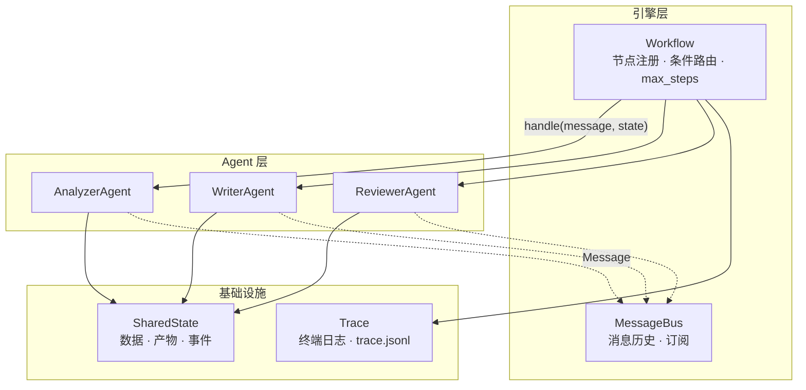
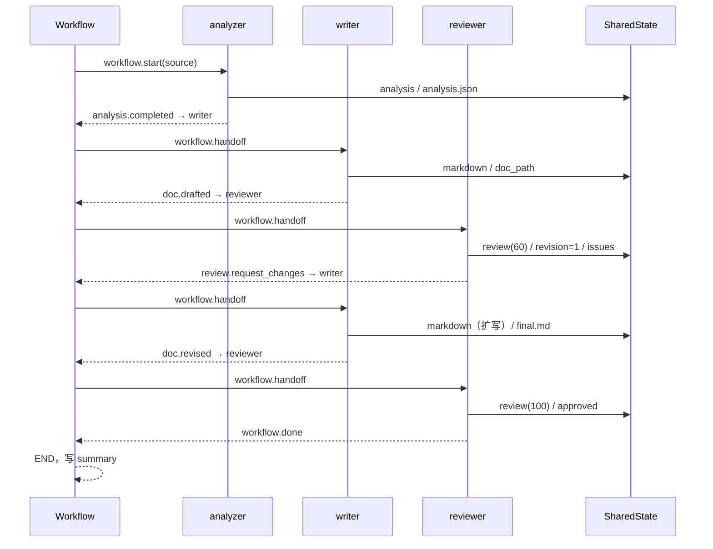

# docflow 设计文档

> Homework 2 · Simple Workflow MVP · 2412190215 俞哲

## 1. 目标与范围

作业要求搭一个 2–3 个 Agent 协作的简单 Workflow，理解编排、通信与状态管理。MVP 的边界我定为：

**输入**一个 Python 源文件，**输出**一份 Markdown API 文档，中间由 3 个 Agent 分工完成，
且流程中必须出现一次"审校不通过 → 回写"的真实回环。

不做的事：多文件/整包分析、LLM 润色、可视化编排界面、并发执行。这些都在第 9 节列为后续工作。

## 2. 选题：为什么是「代码 → 文档」

题目给了 5 个方向，我选「文档生成流程（代码 → 分析 → 文档）」，理由有三条：

1. **输入输出都可验证**。AST 分析是确定的，文档是否覆盖全部公共符号可以自动检查，
   整个流程能写成单元测试，不依赖"看起来对不对"。
2. **天然有审校环节**。文档生成最容易出的问题是"漏符号、漏参数"，正好可以设计一个
   可打分的审校节点，把"条件回环"这个加分项做成流程的一部分，而不是硬凑。
3. **和项目 1 的经验衔接**。项目 1 的代码审查 Agent 已经证明"静态分析 + 规则检查"
   在离线环境下够用；这里复用同样的思路，把"读代码"和"写结论"拆成两个 Agent。

## 3. 总体架构



分层原则：**引擎不认识具体 Agent，Agent 不认识具体下游**。

- 引擎只知道"节点名 + 边 + 条件函数"，因此换流程不用改引擎；
- Agent 只依赖 `Message` 和 `SharedState` 两个契约，因此加节点不用改已有 Agent；
- 日志与状态快照是所有节点共用的横切能力，放在基础设施层。

## 4. 关键设计

### 4.1 消息与状态分离

这是整个设计里最重要的一个决定。

| | 消息（Message） | 状态（SharedState） |
|---|---|---|
| 作用 | 控制流：谁该执行、为什么执行 | 数据流：分析结果、文档、审校结论 |
| 生命周期 | 一次投递，进历史 | 整个 run 期间可读写 |
| 体积 | 小（id、topic、摘要） | 大（完整 AST 结果、Markdown 正文） |
| 谁读 | 引擎路由、日志 | 任意 Agent |

如果只用消息传数据，上游一改字段下游就得跟着改；如果只用共享状态，又没有"该谁执行"
的显式信号。分开之后：

```python
# 控制流：明确告诉引擎下一步去 writer
return message.reply("analysis.completed", {"symbols": 4}, recipient="writer")

# 数据流：完整分析结果放黑板，writer 自己取
state.set("analysis", analysis)
```

代价是状态键需要约定（README 第 3 节有表），但换来的解耦对"可扩展性"这项评分更值。

### 4.2 条件路由

边的定义只有四个字段：`source`、`target`、`when`、`label`。

```python
Edge("reviewer", "writer", when="needs_revision")
Edge("reviewer", END, when="approved")
```

路由规则：

1. 按边的声明顺序找第一条 `source` 匹配的边；
2. `when` 为空 → 无条件命中；否则调用注册的条件函数 `condition(state, reply)`；
3. 没有边命中 → 流程结束；
4. 目标为 `END` 或回复主题为 `workflow.done` → 正常结束；
5. 步数达到 `max_steps` → 报错结束（防配置写错导致死循环）。

条件函数签名统一为 `(SharedState, Optional[Message]) -> bool`，只看状态和回复，
不看引擎内部，所以可以单独测试。

### 4.3 「草稿 → 审校 → 扩写」回环

审校不是走过场，它真的会打回：

| 轮次 | writer 产出 | reviewer 得分 | 结果 |
|------|-------------|---------------|------|
| 1 | 762 字符：签名 + 一句话说明 | 60（缺参数表 25 + 缺示例 15） | `review.request_changes` |
| 2 | 1921 字符：补参数表、返回值、复杂度、示例、覆盖率 | 100 | `workflow.done` |

评分项固定为 6 项，权重集中在 `reviewer.CHECKS`：

```python
("title", 10), ("overview", 10), ("symbols", 25),
("params", 25), ("example", 15), ("placeholder", 15)
```

通过线 85 分，最多重写 2 轮；超过轮次仍不达标则**带 `forced=True` 放行**并记录问题，
避免流程卡死——这是"错误处理与恢复"的体现。

### 4.4 错误处理

| 层 | 手段 | 例子 |
|----|------|------|
| Agent | 抛 `AgentError`，消息带中文原因 | 文件不存在、非 UTF-8、语法错误、缺上游数据 |
| 引擎 | `try/except` 包住 `handle`，记录失败步骤，返回 `ok=False` | 任意 Agent 抛异常都不会让进程崩掉 |
| CLI | 退出码区分 | 正常 0，流程失败 1，输入文件不存在 2 |
| 流程 | `max_steps` 截断 | 路由配错时不会无限循环 |

### 4.5 可扩展性

新增一个节点只需要三步，引擎零改动：

1. 继承 `Agent` 实现 `handle`；
2. 在 `pipeline.REGISTRY` 登记类型名；
3. 在流程配置的 `agents` / `edges` 里加节点和连线（代码或 JSON 均可）。

`Workflow.from_config` 支持完全用 JSON 描述流程，`--config` 即可替换；
`docflow validate` 在运行前校验节点、边和条件名，避免"跑到一半才发现配错"。

## 5. 数据结构

### 5.1 分析结果（`state["analysis"]`）

```json
{
  "path": ".../billing.py",
  "module": "billing",
  "lines": 77,
  "docstring": "计费示例模块。",
  "imports": ["__future__", "uuid"],
  "functions": [
    {
      "name": "create_invoice",
      "signature": "def create_invoice(customer: str, items: list, tax_rate: float = TAX_RATE) -> dict",
      "returns": "dict",
      "docstring": "根据订单明细生成一张发票。...",
      "params": [
        {"name": "customer", "type": "str", "default": "", "kind": "positional", "required": true}
      ],
      "lineno": 14,
      "complexity": 3,
      "public": true,
      "decorators": []
    }
  ],
  "classes": [
    {"name": "InvoiceBook", "docstring": "...", "bases": [], "methods": ["..."]}
  ],
  "missing_docstrings": ["apply_discount"],
  "coverage": {"documented": 6, "total": 7, "ratio": 0.857}
}
```

### 5.2 审校结果（`state["review"]`）

```json
{
  "score": 100,
  "approved": true,
  "round": 2,
  "issues": [],
  "checks": {"title": true, "overview": true, "symbols": true,
             "params": true, "example": true, "placeholder": true}
}
```

### 5.3 消息

```json
{
  "id": "9f3c1a2b",
  "topic": "analysis.completed",
  "sender": "analyzer",
  "recipient": "writer",
  "reply_to": "1a2b3c4d",
  "payload": {"module": "billing", "symbols": 4}
}
```

## 6. 时序



## 7. 与项目 1 的关系

项目 1 是一个代码审查 Agent（静态规则 + 工具调用 + 报告生成）。本项目没有直接复用它的代码，
但复用了两条经验：

1. **AST 优先**。项目 1 里最稳的检查都建立在 AST 上，而不是正则；这里同样用 `ast` 提取签名、
   参数、复杂度和文档覆盖率，避免误报。
2. **规则可测试**。项目 1 把每条规则写成独立可测函数；这里把审校的 6 个检查项做成
   纯函数式的 `_check()`，可以直接喂 Markdown 断言分数。

选择重新写而不是 import 项目 1 的包，是因为项目 1 体量较大（32 个文件 / 约 7000 行），
为一个 2 周 MVP 引入整包依赖会让评审和运行成本变高；这里保持零依赖、单包可读。

## 8. 测试策略

| 层次 | 方式 | 数量 |
|------|------|------|
| 单元 | 消息/状态/分析器/写作/审校各自独立断言 | 16 |
| 集成 | 完整 5 步流程、条件回环、`max_steps`、JSON 配置 | 8 |
| 手工 | `python -m docflow demo` + 检查生成文档 | 1 条命令 |

关键断言举例：

- 草稿版**不含** `| 参数 |` 与 `## 使用示例`（确保回环真的发生）；
- 扩写版**包含**参数表、示例、审校意见处理；
- 伪造 `revision=2` 时 reviewer 必须返回 `workflow.done` 且 `forced=True`；
- 无限回环配置在 4 步后被 `max_steps` 截断，`ok=False` 且错误信息含"最大步数"。

## 9. 已知限制与后续工作

| 限制 | 影响 | 后续做法 |
|------|------|----------|
| 只支持单文件 | 无法给整包生成文档 | 加一个 `scanner` 节点枚举文件，writer 循环调用 |
| 参数说明靠命名启发式 | 语义准确度有限 | 接入 LLM 做一次润色（保持 AST 事实为唯一来源，避免幻觉） |
| 顺序执行 | 多文件时慢 | 引擎已把"节点执行"抽成函数，可加 `ParallelNode` |
| 无持久化 | 进程退出后状态丢失 | `state.json` 已是完整快照，可加 `--resume` 从快照恢复 |
| 无 Web 界面 | 只能命令行 | 复用项目 1 的 Flask 经验加一个只读的流程回放页 |

## 10. 评分对照

| 维度 | 权重 | 本项目的证据 |
|------|------|--------------|
| 流程完整性 | 40% | `demo` 一条命令跑通 3 Agent / 5 步 / 一次回环，产出文档与完整运行记录 |
| Agent 协作 | 30% | 4 类消息 topic + 共享状态黑板；`messages.json` 可逐条回放，`state.json` 可查每步耗时 |
| 可扩展性 | 20% | 注册表 + 条件边 + JSON 配置；新增 Agent 三步完成，引擎不改 |
| 文档 | 10% | README（使用/流程图/扩展）+ 本设计文档（架构/时序/数据结构/测试/限制）+ 示例产物 |
