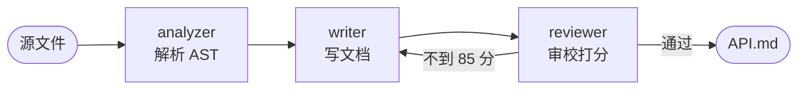

## 运行

```bash
python -m docflow demo
python -m docflow run path/to/module.py -o output/API.md
python -m unittest discover -s tests -v
```


运行日志节选：

```text
[ 0.000s] 启动 workflow「code-to-doc」 起始节点=analyzer 节点数=3
[ 0.003s] analyzer → writer  ·  analysis.completed module=billing, symbols=4, lines=77
[ 0.003s] writer → reviewer  ·  doc.drafted chars=758, revision=0
[ 0.004s] reviewer → writer  ·  review.request_changes score=60, round=1
[ 0.004s] writer → reviewer  ·  doc.revised chars=1917, revision=1
[ 0.004s] reviewer → workflow  ·  workflow.done score=100, round=2
[ 0.004s] 结束：成功｜5 步｜4 ms
```


## 流程



流程写在 `docflow/pipeline.py`，一共四个节点（含结束）和四条边：

```
analyzer ──▶ writer ──▶ reviewer ──[approved]──▶ END
                ▲            │
                └────────────┘
                [needs_revision]
```

结束时有两种情况：走到 `END`，或者收到 `workflow.done` 消息。引擎里还有个
`max_steps`（默认 12），连线配错时不至于死循环。

## 三个 Agent

**analyzer** 用 `ast` 解析源码，拿到模块说明、导入、类、函数签名、参数默认值、
docstring 和圈复杂度，顺便统计文档覆盖率。结果写进共享状态，也存一份
`analysis.json` 当产物。

**writer** 把分析结果转成 Markdown。第一次只写签名和一句说明，是草稿；被审校打回
以后，再补参数表、返回值、复杂度和一段能跑的示例。

**reviewer** 检查六项：标题、模块概览、公共符号是否都写了、参数表、使用示例、
有没有 TODO 占位符。每项有固定分值，满分 100，85 分算通过。不通过就发
`review.request_changes` 给 writer，最多重写 2 轮；还不通过就带 `forced` 标记放行，
免得整个流程卡住。

## 消息和共享状态

Agent 之间只传消息，消息里放 topic 和少量摘要，完整数据放在共享状态。

```python
# analyzer 里
state.set("analysis", analysis)
return message.reply("analysis.completed", {"module": "billing"}, recipient="writer")

# writer 里
analysis = state.get("analysis")
```

消息决定下一步去哪，状态负责存数据。这样加新节点时不用改上游 Agent。

状态里常用的 key：

| key | 谁写 | 内容 |
|-----|------|------|
| analysis | analyzer | 解析结果 |
| markdown / doc_path | writer | 文档正文和路径 |
| revision / review_issues | reviewer | 重写轮次和打回原因 |
| review | reviewer | 分数和逐项检查结果 |
| messages / events | 引擎 | 消息流水和事件 |

## 目录结构

```
hw2-workflow-mvp/
├── README.md
├── Design.md
├── requirements.txt
├── docflow/
│   ├── agent.py          Agent 基类
│   ├── message.py        Message 和 MessageBus
│   ├── state.py          共享状态
│   ├── trace.py          终端日志和 trace.jsonl
│   ├── workflow.py       引擎
│   ├── pipeline.py       默认流程、注册表、条件
│   ├── cli.py            命令行
│   └── agents/
│       ├── analyzer.py
│       ├── writer.py
│       └── reviewer.py
├── examples/billing.py
├── workflows/fast.json
├── docs/
│   ├── demo_log.txt
│   └── sample_output.md
└── tests/
```

## 加节点、换流程

写一个 Agent 子类，在 `pipeline.REGISTRY` 里登记，再在配置里加节点和边，引擎不用改。

```python
class GlossaryAgent(Agent):
    name = "glossary"

    def handle(self, message, state):
        markdown = state.get("markdown", "")
        state.set("glossary", [])
        return message.reply("glossary.ready", {}, recipient="reviewer")
```

流程也能用 JSON 写。`workflows/fast.json` 是跳过审校的版本：

```bash
python -m docflow run examples/billing.py --config workflows/fast.json -o output/fast.md
python -m docflow validate --config workflows/fast.json
```

`validate` 只检查配置，不执行流程，会看起始节点、连线两端的节点和条件名有没有写错。

## 运行记录

每次运行会在 `runs/<时间戳>/` 下留三个文件：

- `trace.jsonl`：逐条事件，带毫秒时间
- `state.json`：状态快照，包含分数、每步耗时
- `messages.json`：完整的消息流水

出错的时候直接翻这三个文件就行，比在终端里往上滚方便。

## 测试

```bash
python -m unittest discover -s tests -v
```

24 项，跑完 0.04 秒左右。

- `test_core.py`：消息回复、总线历史、状态读写和快照
- `test_analyzer.py`：签名、参数、私有符号过滤、覆盖率、语法错误
- `test_agents_doc.py`：草稿内容、扩写内容、打回、复审通过、强制放行
- `test_workflow.py`：完整 5 步、条件回环、max_steps、非法连线、JSON 配置


