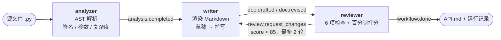

# docflow · 三个 Agent 协作的「代码 → 文档」Workflow

> SE2026 Homework 2 · Simple Workflow MVP
> 学号 **2412190215** · 姓名 **俞哲** · 2026-10-25
>
> 仓库地址：**（推送后填写，见文末「提交信息」）**

`docflow` 读取一个 Python 源文件，由 **分析 Agent → 写作 Agent → 审校 Agent** 依次协作，
产出一份带参数表、返回值、复杂度与可运行示例的 Markdown API 文档。审校不通过时，
流程会**自动回到写作节点重写**，形成"顺序执行 + 条件回环"的最小闭环。

整个项目**只用 Python 标准库**（3.9+），不需要 API Key、不需要联网、不需要安装依赖，
克隆下来就能跑。

---

## 1. 一分钟跑通

```bash
# 1) 用内置示例跑完整流程（分析 → 草稿 → 审校 60 分 → 扩写 → 审校 100 分）
python -m docflow demo

# 2) 对自己的文件生成文档
python -m docflow run path/to/your_module.py -o output/API.md

# 3) 查看已注册的 Agent
python -m docflow agents

# 4) 跑单元测试（24 项，约 0.05 秒）
python -m unittest discover -s tests -v
```

`demo` 的预期输出（节选，完整实录见 [`docs/demo_log.txt`](docs/demo_log.txt)）：

```text
[ 0.000s] 启动 workflow「code-to-doc」 起始节点=analyzer 节点数=3
[ 0.000s] workflow → analyzer  ·  workflow.start source=...\examples\billing.py
[ 0.001s] ▶ analyzer 处理 workflow.start
[ 0.001s] analyzer → writer  ·  analysis.completed module=billing, symbols=4, lines=77
[ 0.001s] → 跳转 analyzer → writer
[ 0.001s] ▶ writer 处理 workflow.handoff
[ 0.001s] writer → reviewer  ·  doc.drafted chars=762, revision=0
[ 0.001s] ▶ reviewer 处理 workflow.handoff
[ 0.001s] reviewer → writer  ·  review.request_changes score=60, round=1
[ 0.001s] → 跳转 reviewer → writer
[ 0.001s] ▶ writer 处理 workflow.handoff
[ 0.002s] writer → reviewer  ·  doc.revised chars=1921, revision=1
[ 0.002s] ▶ reviewer 处理 workflow.handoff
[ 0.002s] reviewer → workflow  ·  workflow.done score=100, round=2, forced=False
[ 0.002s] ✓ reviewer 宣布流程完成
[ 0.002s] 结束：成功｜5 步｜4 ms
```

产物：`output/billing_API.md`；运行记录：`runs/<时间戳>/`。

---

## 2. 流程图



流程由四个节点（含 `END`）和四条边组成，定义在
[`docflow/pipeline.py`](docflow/pipeline.py) 的 `DEFAULT_PIPELINE` 中：

```
analyzer ──▶ writer ──▶ reviewer ──[approved]──▶ END
                ▲            │
                └────────────┘
                [needs_revision]
```

`reviewer` 的两条出边带条件，**先命中先走**；无条件边作为兜底。到达 `END`
或收到 `workflow.done` 主题消息时流程结束，`max_steps`（默认 12）兜底防死循环。

---

## 3. Agent 与消息

| 节点 | 职责 | 输入消息 | 输出消息 |
|------|------|----------|----------|
| `analyzer` | 解析源码得到模块、导入、类、函数签名、参数、docstring、圈复杂度、文档覆盖率 | `workflow.start`（含 `source`） | `analysis.completed` → `writer` |
| `writer` | 把分析结果渲染成 Markdown；首次出简版草稿，被打回后补参数表 / 返回值 / 示例 | `analysis.completed` 或 `workflow.handoff` | `doc.drafted` / `doc.revised` → `reviewer` |
| `reviewer` | 按 6 个固定检查项打分（满分 100，85 分通过），未通过则打回 | `doc.drafted` / `doc.revised` | `review.request_changes` → `writer`，或 `workflow.done` → 结束 |

**消息负责"控制流"，共享状态负责"数据流"** —— 两者分开，是为了让新增 Agent
不必知道上游是谁：

```python
# Agent 之间只传一条消息；真正的数据在 SharedState 里
return message.reply("analysis.completed", {"module": "billing", "symbols": 4},
                     recipient="writer")

# 下游从共享状态取数据，而不是从消息里抠
analysis = state.get("analysis")
```

共享状态里约定俗成的键：

| 键 | 写入者 | 内容 |
|----|--------|------|
| `source_path` / `analysis` | analyzer | 源码路径与结构化分析结果 |
| `markdown` / `doc_path` | writer | 文档正文与落盘路径 |
| `revision` / `review_issues` | reviewer | 重写轮次与打回意见 |
| `review` | reviewer | 分数、是否通过、逐项检查结果 |
| `messages` / `events` | 引擎 | 完整消息流水与事件流 |

---

## 4. 目录结构

```
hw2-workflow-mvp/
├── README.md                 本文件：项目说明、快速开始、使用方法
├── Design.md                 设计文档：选型、架构、关键决策、测试
├── requirements.txt          依赖说明（无第三方依赖）
├── docflow/
│   ├── agent.py              Agent 抽象基类、AgentError
│   ├── message.py            Message / MessageBus
│   ├── state.py              SharedState（线程安全黑板）
│   ├── trace.py              终端彩色日志 + trace.jsonl
│   ├── workflow.py           引擎：节点、条件边、路由、执行
│   ├── pipeline.py           注册表 + 默认流程 + 条件
│   ├── cli.py                命令行入口
│   └── agents/
│       ├── analyzer.py       AST 分析 Agent
│       ├── writer.py         Markdown 写作 Agent
│       └── reviewer.py       审校 Agent
├── examples/
│   └── billing.py            示例模块（含 1 个故意缺 docstring 的函数）
├── workflows/
│   └── fast.json             配置化流程示例：跳过审校的快速模式
├── docs/
│   ├── demo_log.txt          一次完整运行的终端实录
│   └── sample_output.md      demo 生成的 API 文档样例
├── tests/                    24 项单元测试
└── runs/                     （运行时生成，已 gitignore）
```

---

## 5. 扩展方式

### 5.1 加一个 Agent

```python
from docflow.agent import Agent

class GlossaryAgent(Agent):
    name = "glossary"
    description = "从文档中抽取术语表"

    def handle(self, message, state):
        markdown = state.get("markdown", "")
        state.set("glossary", [...])
        return message.reply("glossary.ready", {...}, recipient="reviewer")
```

然后在 `docflow/pipeline.py` 的 `REGISTRY` 里登记 `"glossary": GlossaryAgent`，
再在配置里加一个节点和两条边即可，**引擎代码一行都不用改**。

### 5.2 换一条流程

流程可以完全用 JSON 描述，`--config` 指定：

```json
{
  "name": "fast-doc",
  "start": "analyzer",
  "max_steps": 6,
  "agents": [
    {"name": "analyzer", "type": "analyzer"},
    {"name": "writer", "type": "writer"}
  ],
  "edges": [
    {"from": "analyzer", "to": "writer"},
    {"from": "writer", "to": "__end__"}
  ]
}
```

```bash
python -m docflow run examples/billing.py --config workflows/fast.json -o output/fast.md
python -m docflow validate --config workflows/fast.json   # 只校验、不执行
```

`validate` 会在启动前检查：起始节点存在、所有边的两端可达、条件名已注册。

---

## 6. 运行记录与可观测性

每次运行都会生成 `runs/<时间戳>/`：

| 文件 | 内容 |
|------|------|
| `trace.jsonl` | 每行一个事件：`workflow` / `message` / `agent` / `error` / `done`，带毫秒时间 |
| `state.json` | 共享状态快照（含产物大小、事件数、审查分数、每步耗时） |
| `messages.json` | 完整消息流水（topic、sender、recipient、payload、reply_to） |

这满足评分里"执行日志与状态追踪"的推荐项，也方便出问题时回放。
加 `--json` 可以把状态快照直接打到 stdout，接到其他脚本里。

错误处理分三层：

1. **Agent 内部**主动抛 `AgentError`（文件不存在、语法错误、缺上游数据），带中文原因；
2. **引擎**统一捕获异常，记录失败步骤，返回 `ok=False`，CLI 退出码 `1`；
3. **超步数保护**：路由配置写错导致死循环时，`max_steps` 截断并报错。

```bash
$ python -m docflow run broken.py
找不到源文件：...\broken.py          # 退出码 2
```

---

## 7. 测试

```bash
python -m unittest discover -s tests -v
```

| 测试文件 | 覆盖内容 |
|----------|----------|
| `test_core.py` | 消息回复关联、总线历史/订阅容错、状态读写/深拷贝/产物隔离 |
| `test_analyzer.py` | 模块信息、签名与参数、私有符号过滤、覆盖率统计、语法错误包装 |
| `test_agents_doc.py` | 草稿为简版、扩写补表格与示例、审校打回、复审通过、超轮次强制放行 |
| `test_workflow.py` | 端到端 5 步、条件回环、`max_steps` 保护、非法边校验、JSON 配置构建 |

当前结果：**24 passed / 0.05s**。

---

## 8. 设计取舍

| 取舍 | 原因 |
|------|------|
| 不用 LLM，纯 AST + 规则 | 作业要求"MVP 可运行"，离线可复现；不依赖 Key 和网络，评审老师 clone 下来即可验证 |
| 消息与状态分离 | 消息只做控制流，状态做数据流；新增节点不必改上游，符合"可扩展性"要求 |
| 先草稿再扩写 | 真实文档流程就是"先定结构、再补细节"；也顺带演示条件回环和状态驱动的重试 |
| 审校用固定检查项 | 打分可解释、可测试，不引入主观判断；权重集中在 `reviewer.CHECKS` 一处，便于调整 |
| 单文件输入 | MVP 范围可控；多文件/整包分析放在"后续工作"（见 Design.md） |

---

## 9. 评分对照

| 维度（权重） | 本项目对应 |
|--------------|------------|
| 流程完整性 40% | `python -m docflow demo` 一条命令跑通 5 步（含一次打回重写），产出 `output/billing_API.md`；3 个 Agent 全部参与 |
| Agent 协作 30% | 3 个 Agent 通过 `Message` 通信（4 类 topic），数据经 `SharedState` 共享；`messages.json` 可逐条回放 |
| 可扩展性 20% | 注册表 + 配置化流程；新增 Agent 只需"写类 + 登记 + 加边"；`--config` 可替换整条流程 |
| 文档 10% | 本 README + [`Design.md`](Design.md)（架构、时序、数据结构、测试策略）+ 流程图 |

---

## 10. 提交信息

| 项 | 内容 |
|----|------|
| 课程 | SE2026 |
| 作业 | Homework 2 · Simple Workflow MVP |
| 学号 / 姓名 | 2412190215 / 俞哲 |
| 代码仓库 | **（推送后填写 GitHub URL）** |
| 演示视频 | 可选，本次未提交；终端实录见 [`docs/demo_log.txt`](docs/demo_log.txt) |
| 备份压缩包 | `2412190215俞哲.zip`（含 `.git` 历史，< 200 MB） |

---

## License

课程作业，仅用于 SE2026 评审。
